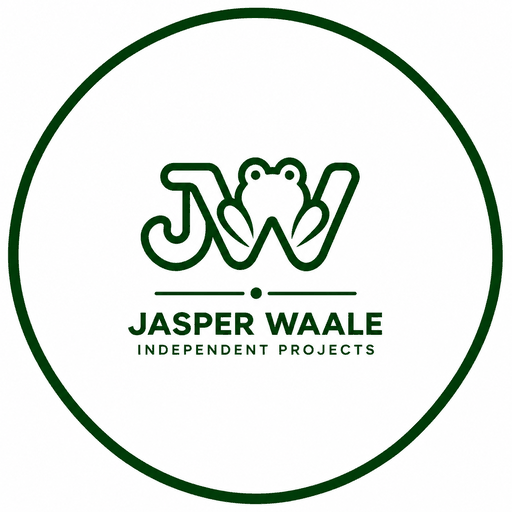

  

<h1 align="center">Jasper Waale</h1>

<strong>Independent Developer &amp; Researcher</strong> 
Technology, Open Source &amp; Community Projects

I'm an independent developer and researcher based in Vietnam, building technology and
community-driven projects focused on practical solutions, transparency, open collaboration,
and public benefit.

My work includes spam research, event discovery, environmental awareness, local appliance
control, and open-source software development.

I believe useful technology should remain accessible, understandable, and maintainable.

## Universal Appliance Local Control (UALC)

**Repository:** https://github.com/jaspweowaale/universal-appliance-local-control
**Background reading:** [Why we're building UALC](https://www.linkedin.com/pulse/why-were-building-universal-appliance-local-control-ualc-jasper-waale-0yhcc)

> **Software support should not determine the lifespan of perfectly good hardware.**

An open-source project exploring authorized local appliance communication, reusable device
profiles, and reduced dependence on manufacturer cloud services.

Most connected appliances work perfectly well as machines, but stop being useful the moment a
manufacturer retires an app or shuts down a server. UALC investigates whether that dependency
can be loosened — by speaking to appliances over the local network they already support,
rather than by replacing what is on them.

**What the project is trying to establish**

- Local appliance communication **without requiring replacement firmware**.
- **No required physical modification and no firmware flashing** — the research deliberately
  favours non-invasive approaches over opening or re-flashing hardware. Because nothing is
  physically altered or overwritten, this avoids some of the obvious warranty concerns that
  come with modding; it is **not** a guarantee that any particular warranty is preserved, and
  that remains between an owner and their manufacturer.
- Greater **ownership and control of locally available device data**.
- **Reduced dependence on manufacturer cloud services**, so a device keeps working when a
  service does not.
- **Reusable device profiles** and a common development foundation, so support for a new model
  builds on earlier work instead of restarting it.
- **Longer useful device lifespans and less electronic waste.**
- **Community collaboration and open research** — the bottleneck is hardware access, not code.

**Current status — pre-alpha.** This is a research and infrastructure project, not finished
software. **No appliance is controllable through the UALC framework on real hardware today.**
What exists is the architecture, the contribution model, and an offline-tested foundation. The
[status matrix](https://github.com/jaspweowaale/universal-appliance-local-control/blob/main/docs/STATUS_MATRIX.md)
records exactly what is and is not verified, and is the authoritative statement of maturity.

## Projects

| Project | What it is | Status |
|---|---|---|
| [Spam Hunter](https://spamhunter.org) | Independent anti-spam research, evidence preservation, public education and reporting resources | Live |
| [Salty Bever](https://saltybever.com) | Independent discovery of events, performances and cultural activities across Southeast Asia | Live |
| [Phố Sạch](https://phosach.app) | Community tools encouraging environmental awareness and cleaner public spaces in Vietnam | Live |
| [Holistic Data](https://holisticdata.com) | Open, interoperable tools for local control and data ownership; UALC is its first project | Pre-alpha |

## Research repositories

| Repository | Focus | Hardware status |
|---|---|---|
| [toshiba-tsmartlife-local](https://github.com/jaspweowaale/toshiba-tsmartlife-local) | Local communication with compatible Toshiba/Midea-based appliances, with a Home Assistant companion | **Verified working on real hardware** |
| [ariston-lydos-uart-research](https://github.com/jaspweowaale/ariston-lydos-uart-research) | Local, read-only UART telemetry for the Ariston VELIS Lydos water heater (CN6 connector), as a passive ESPHome design | **Untested on real hardware** — seeking community help |

These are at genuinely different stages, and the table says which is which on purpose. Toshiba
is confirmed against a real appliance; Ariston is a design that has never been connected to
one; UALC above is earlier still.

## Open-source philosophy

I try to build practical tools that solve real problems rather than demonstrate techniques, and
to publish the research behind them so the knowledge is shared rather than re-derived. Where it
makes sense I prefer reusable foundations over one-off solutions, so later work can build on
earlier work instead of replacing it.

Privacy and local control matter to me: software should keep working when a network does not,
and reducing unnecessary cloud dependencies is part of that. It is also an e-waste question —
extending the usable life of hardware that still works perfectly well is often the most
practical environmental contribution a developer can make.

Not everything here is finished, and I try to label project status honestly — several of these
are research or pre-alpha rather than finished software, and each repository's own LICENSE file
is the authoritative statement of how that code may be used.

## Support independent development

My projects are independently researched, developed, and maintained.

If you find the work useful, voluntary contributions help support infrastructure, research,
testing, documentation, and continued development.

**Support my projects on Ko-fi:** https://ko-fi.com/jasperwaale

One Ko-fi account supports all of these projects collectively — contributions are not directed
to any single one.

Contributions are entirely voluntary. They do not grant preferential treatment, guaranteed
features, or special access, and they never influence research findings, technical decisions, or
how any report or submission is handled.

## Contact and links

- GitHub: https://github.com/jaspweowaale
- Ko-fi: https://ko-fi.com/jasperwaale
- Spam Hunter: https://spamhunter.org
- Salty Bever: https://saltybever.com
- Phố Sạch: https://phosach.app
- Holistic Data: https://holisticdata.com
